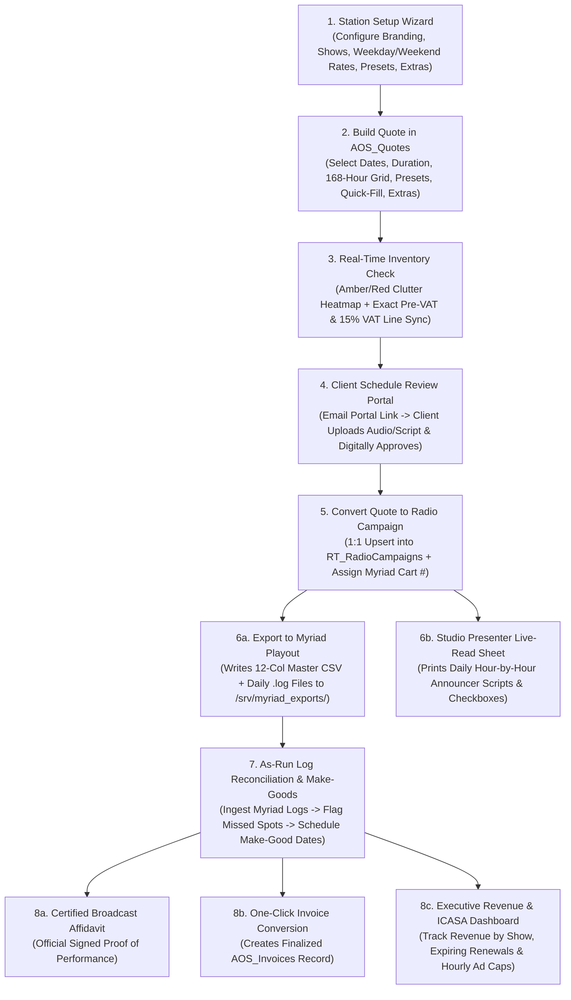

# CRMSuite — Radio Station Advertising, Traffic & Playout Management Platform
**Complete Technical, Administrator & User Documentation (Full Build Reference)**  
**Platform Base**: SuiteCRM 8.10.1 (`PHP 8.3`, `MariaDB 10.11`, `Apache 2.4`, `Symfony 5.4` + `Angular 18`)

---

## Table of Contents
1. [Executive Summary & System Capabilities](#1-executive-summary--system-capabilities)
2. [System Architecture & Directory Structure](#2-system-architecture--directory-structure)
3. [End-to-End Broadcast Sales, Traffic & Playout Workflow](#3-end-to-end-broadcast-sales-traffic--playout-workflow)
4. [Module 1: Station Setup & Rate Card Onboarding Wizard](#4-module-1-station-setup--rate-card-onboarding-wizard)
   - [4.1 Tab 1 — Station Branding, Legal Identity & Financial Defaults](#41-tab-1--station-branding-legal-identity--financial-defaults)
   - [4.2 Tab 2 — Dynamic Show Schedule & Weekday/Weekend Rate Card Slots](#42-tab-2--dynamic-show-schedule--weekdayweekend-rate-card-slots)
   - [4.3 Tab 3 — Package Deals & Quick-Select Presets](#43-tab-3--package-deals--quick-select-presets)
   - [4.4 Tab 4 — Ad Durations, Multipliers & Catalogue Extras](#44-tab-4--ad-durations-multipliers--catalogue-extras)
   - [4.5 Tab 5 — Traffic, ICASA & Myriad Playout Rules](#45-tab-5--traffic-icasa--myriad-playout-rules)
   - [4.6 Tab 6 — Backup & Portable JSON Station Profile Import/Export](#46-tab-6--backup--portable-json-station-profile-importexport)
5. [Module 2: Dynamic Rate Card & Pricing Engine (`RadioScheduleService`)](#5-module-2-dynamic-rate-card--pricing-engine-radioscheduleservice)
   - [5.1 Weekday (Mon–Fri) vs. Weekend (Sat–Sun) Rate Calculation](#51-weekday-monfri-vs-weekend-satsun-rate-calculation)
   - [5.2 Ad Duration Scaling Multipliers (`15s`, `30s`, `45s`, `60s`)](#52-ad-duration-scaling-multipliers-15s-30s-45s-60s)
   - [5.3 Exact Package Preset Target Pre-VAT Pricing & Proration](#53-exact-package-preset-target-pre-vat-pricing--proration)
   - [5.4 Calendar Weekday Occurrence Math](#54-calendar-weekday-occurrence-math)
6. [Module 3: Weekly Advert Schedule Matrix & Quote Builder (`AOS_Quotes`)](#6-module-3-weekly-advert-schedule-matrix--quote-builder-aos_quotes)
   - [6.1 168-Cell Weekly Flighting Grid (`24 Hours × 7 Days`)](#61-168-cell-weekly-flighting-grid-24-hours--7-days)
   - [6.2 One-Click Package Presets Bar](#62-one-click-package-presets-bar)
   - [6.3 Auto-Distribute Quick-Fill Scheduler (By Spot Count or Budget)](#63-auto-distribute-quick-fill-scheduler-by-spot-count-or-budget)
   - [6.4 Production & Value-Add Extras Bundler](#64-production--value-add-extras-bundler)
   - [6.5 Real-Time Inventory Availability & Hourly Clutter Warnings](#65-real-time-inventory-availability--hourly-clutter-warnings)
   - [6.6 Server-Side Quote Line-Item Synchronization (`RadioQuoteScheduleProducts`)](#66-server-side-quote-line-item-synchronization-radioquotescheduleproducts)
7. [Module 4: Radio Campaigns (`RT_RadioCampaigns`)](#7-module-4-radio-campaigns-rt_radiocampaigns)
   - [7.1 Idempotent Quote-to-Campaign Conversion](#71-idempotent-quote-to-campaign-conversion)
   - [7.2 Campaign Status Lifecycle & Custom Fields](#72-campaign-status-lifecycle--custom-fields)
8. [Module 5: Myriad Playout Automation Export Engine](#8-module-5-myriad-playout-automation-export-engine)
   - [8.1 Pre-Flight Validation Rules](#81-pre-flight-validation-rules)
   - [8.2 Intra-Hour Even Spot Spacing Formula](#82-intra-hour-even-spot-spacing-formula)
   - [8.3 Master 12-Column CSV & Daily `.log` Output Formats](#83-master-12-column-csv--daily-log-output-formats)
   - [8.4 SuiteCRM 8 Symfony Action vs. Legacy EntryPoint](#84-suitecrm-8-symfony-action-vs-legacy-entrypoint)
9. [Module 6: Playout As-Run Log Reconciliation & Make-Good Rescheduler](#9-module-6-playout-as-run-log-reconciliation--make-good-rescheduler)
   - [9.1 Automated As-Run Log Matching](#91-automated-as-run-log-matching)
   - [9.2 Interactive Make-Good Compensatory Spot Rescheduler](#92-interactive-make-good-compensatory-spot-rescheduler)
10. [Module 7: Studio Presenter Live-Read & Sponsorship Run-Sheets](#10-module-7-studio-presenter-live-read--sponsorship-run-sheets)
11. [Module 8: Client Approval Portal, Creative Upload & Email Dispatch](#11-module-8-client-approval-portal-creative-upload--email-dispatch)
12. [Module 9: Certified Broadcast Affidavits & One-Click Invoice Conversion](#12-module-9-certified-broadcast-affidavits--one-click-invoice-conversion)
13. [Module 10: Executive Revenue, Renewal & ICASA Compliance Dashboard](#13-module-10-executive-revenue-renewal--icasa-compliance-dashboard)
14. [Database Schema, Custom Tables & Relationships](#14-database-schema-custom-tables--relationships)
15. [Complete EntryPoints, Admin Actions & CLI Scripts Reference](#15-complete-entrypoints-admin-actions--cli-scripts-reference)
16. [Deployment, Backup/Restore & Automated Test Suites](#16-deployment-backuprestore--automated-test-suites)

---

## 1. Executive Summary & System Capabilities

**CRMSuite (Radio CRM)** is a full-lifecycle broadcast sales, traffic scheduling, playout automation, and regulatory compliance platform built on **SuiteCRM 8.10.1**. It bridges the gap between commercial radio advertising sales and studio playout engineering (**Broadcast Radio Myriad**).

### Core Problems Solved
1. **Complex Broadcast Pricing**: Radio stations charge different rates for **Weekdays (Mon–Fri)** vs. **Weekends (Sat–Sun)** across distinct show dayparts (Breakfast, Mid-Morning, Lunch, Afternoon Drive, Evenings, Late Night), scaled by ad duration (`15s`, `30s`, `45s`, `60s`), or sold as fixed-price monthly/bi-monthly **Package Presets** (e.g., `R5,999.00` pre-VAT).
2. **Visual 168-Hour Flighting**: Standard CRM quote line items cannot represent a 24-hour × 7-day broadcast grid. CRMSuite embeds a 168-cell interactive schedule matrix directly inside `AOS_Quotes`, automatically converting the grid into itemized, VAT-accurate Quote line items and clean client PDFs.
3. **ICASA Commercial Cap & Inventory Protection**: Prevents over-bookingprime-time hours beyond the station's regulatory commercial minutes cap (e.g., 10 minutes / 20 spots per hour) with real-time amber/red heatmap warnings during quote creation.
4. **Zero-Touch Studio Playout Export**: Eliminates manual traffic re-entry into Myriad Playout by exporting frame-accurate 12-column Master CSVs and daily `.log` files directly to `/srv/myriad_exports/`.
5. **Closed-Loop Proof of Performance**: Ingests Myriad As-Run logs to verify every spot aired, provides a 1-click **Make-Good Rescheduler** for any missed spots, prints daily **Studio Presenter Live-Read Run-Sheets**, issues **Certified Broadcast Affidavits**, and converts fulfilled campaigns into **SuiteCRM Invoices (`AOS_Invoices`)**.

---

## 2. System Architecture & Directory Structure

```text
/opt/suitecrm/ (or /home/ubuntu/suitecrm/)
├── Dockerfile                          # Ubuntu 24.04 + Apache 2.4 + PHP 8.3 container definition
├── docker-compose.yml                  # Orchestrates radio_crm_web + radio_crm_mariadb
├── install_radio_crm.sh                # Master installer, migration runner & verification script
├── INSTALL.md                          # Multi-server & multi-station deployment guide
├── README.md                           # Quick-start & architecture overview
├── MANIFEST.sha256                     # SHA-256 integrity manifest of all repository files
├── docs/
│   └── CRMSuite_Full_Documentation.md  # Complete technical & user manual
├── migrations/
│   ├── 001_create_rt_radiocampaigns_tables.php
│   ├── 002_create_aos_quotes_schedule_columns.php
│   ├── 003_seed_radio_catalogue_products.php
│   ├── 004_professional_quote_pdf_template.php
│   ├── 005_radio_crm_market_enhancements.php
│   ├── 006_radio_station_settings_table.php
│   └── 007_quick_repair_and_rebuild.php
├── scripts/
│   ├── preflight.sh                    # Checks Docker, MariaDB, Apache & filesystem permissions
│   ├── backup.sh                       # Full DB + custom file snapshot & restore script generator
│   ├── deploy.sh                       # Syncs src/ to /var/www/html, runs migrations & clears cache
│   ├── smoke_test.sh                   # Executes all 57 automated acceptance & verification tests
│   ├── setup_station.php               # CLI utility for station profile inspection & JSON import/export
│   ├── reconcile_myriad_logs.php       # CLI & library engine for Myriad As-Run log reconciliation
│   └── generate_icasa_report.php       # CLI generator for monthly ICASA compliance CSVs
├── src/
│   ├── extensions/defaultExt/
│   │   ├── config/modules/RT_RadioCampaigns/recordview/actions/export-to-myriad.php
│   │   └── modules/RT_RadioCampaigns/Process/Service/RecordActions/ExportToMyriadAction.php
│   └── public/legacy/
│       ├── custom/
│       │   ├── convert_quote_to_radio_campaign.php
│       │   ├── convert_campaign_to_invoice.php
│       │   ├── export_radio_campaign_to_myriad.php
│       │   ├── generate_broadcast_affidavit.php
│       │   ├── generate_presenter_liveread_sheet.php
│       │   ├── radio_campaign_client_review.php
│       │   ├── radio_crm_documentation.php
│       │   ├── radio_schedule_ajax_sync.php
│       │   ├── radio_station_dashboard.php
│       │   ├── radio_station_wizard.php
│       │   ├── reconcile_radio_campaign_logs.php
│       │   ├── send_radio_client_email.php
│       │   ├── include/RadioCRM/
│       │   │   ├── RadioScheduleService.php
│       │   │   └── RadioStationConfigService.php
│       │   ├── modules/Administration/
│       │   │   ├── radio_documentation.php
│       │   │   ├── radio_liveread_sheet.php
│       │   │   ├── radio_station_dashboard.php
│       │   │   └── radio_station_wizard.php
│       │   └── modules/AOS_Quotes/
│       │       ├── RadioQuoteScheduleProducts.php
│       │       ├── views/view.edit.php
│       │       ├── views/view.detail.php
│       │       └── tpls/weekly_advert_schedule.tpl
│       └── modules/RT_RadioCampaigns/
└── tests/
    ├── run_acceptance_tests.php        # 22 core end-to-end acceptance tests
    ├── run_ui_http_tests.php           # 5 DOM hierarchy & Symfony service container tests
    ├── test_radio_enhancements.php     # 16 market enhancement & compliance tests
    └── test_station_wizard.php         # 14 Station Setup Wizard & dynamic rate card tests
```

---

## 3. End-to-End Broadcast Sales, Traffic & Playout Workflow



---

## 4. Module 1: Station Setup & Rate Card Onboarding Wizard

**URL**: `index.php?module=Administration&action=radio_station_wizard`  
**Source File**: `src/public/legacy/custom/radio_station_wizard.php`  
**Service Layer**: `src/public/legacy/custom/include/RadioCRM/RadioStationConfigService.php`

The Station Setup Wizard provides a 6-tab management console for all station settings. Every change saved in the wizard is persisted in the `radio_station_settings` MariaDB table and automatically synchronized with the `aos_products` product catalogue.

### 4.1 Tab 1 — Station Branding, Legal Identity & Financial Defaults
- **Station Identity**: Station Name, Frequency (`e.g., 93.6 FM`), Callsign, Slogan/Tagline, Broadcast Language, Geographic Region, and License Type (`Community`, `Commercial`, `Campus`, `Public`).
- **Logo Upload**: Upload a PNG, JPG, SVG, or WebP station logo (`upload/station_logo.*`) which automatically appears on Quotes, Client Review Portals, Broadcast Affidavits, and Executive Dashboards.
- **Contact & Legal Signatory**: Physical Address, Phone, Sales Email, Website, Station Manager Name & Title (used on Broadcast Affidavits), and Traffic Manager contact details.
- **Financial, Tax & Banking Details**: Currency Symbol (`R`), Currency Code (`ZAR`), VAT/Tax Rate (`15.0%`), VAT Registration Number, Quote Validity Days (`14`), Payment Terms, Bank Name, Account Name, Account Number, Branch Code, and Payment Reference instructions.

### 4.2 Tab 2 — Dynamic Show Schedule & Weekday/Weekend Rate Card Slots
- **Dynamic Add/Remove**: Click **+ Add Show / Timeband** to add new broadcast timebands or **Remove** to delete unused rows.
- **Configurable Fields per Show**:
  - **Product Code (`part_number`)**: Editable SKU synced to `aos_products` (e.g., `RAD-SLOT-1`).
  - **Show / Timeband Name**: Display name shown in the Quote schedule matrix and client PDFs (e.g., `Breakfast Show`, `Afternoon Drive`).
  - **Active Hours Spec**: Supports contiguous ranges (`6-8` for `06:00–09:00`) or comma-separated overnight ranges (`0-5,21-23` for `21:00–06:00`).
  - **Weekday 30s Rate (Mon–Fri)**: Base price for a 30-second commercial on Monday through Friday.
  - **Weekend 30s Rate (Sat–Sun)**: Base price for a 30-second commercial on Saturday and Sunday.
  - **Hours Label / Description**: Human-readable timeband label (`06:00-09:00`).

### 4.3 Tab 3 — Package Deals & Quick-Select Presets
- Configure unlimited 1-click **Package Presets** displayed on the Quote schedule screen.
- Each package defines:
  - **Package Name** (e.g., `Preset 1: 30 Sec Ads — 1 Month (60 Spots)`)
  - **Package Type / Duration & Campaign Weeks**
  - **Total Spots** (`60`, `120`, etc.)
  - **Target Pre-VAT Package Price** (`R 5,999.00`, `R 10,800.00`, `R 9,100.00`, `R 16,250.00`)
  - **Slot Distribution Profile** (`Prime Drive`, `Daytime Mix`, `All-Day Rotation`, or custom hour/day matrix)

### 4.4 Tab 4 — Ad Durations, Multipliers & Catalogue Extras
- **Duration Multipliers**: Editable scaling factors relative to the 30-second base rate:
  - `15s` = `0.50` (`50%`)
  - `30s` = `1.00` (`100%`)
  - `45s` = `1.50` (`150%`)
  - `60s` = `2.00` (`200%`)
- **Production & Sponsorship Extras**: Editable catalogue of non-spot items (`RAD-PROD-VOICE`, `RAD-PROD-JINGLE`, `RAD-LIVE-READ`, `RAD-SPON-TAG`, `RAD-OB-BROADCAST`, `RAD-VOX-POP`, etc.) with custom product codes, names, categories, and unit prices synced directly to `aos_products`.

### 4.5 Tab 5 — Traffic, ICASA & Myriad Playout Rules
- **ICASA Commercial Cap**: Maximum commercial minutes per hour (default `10` minutes) and maximum spots per hour (`20`).
- **Myriad Cart Number Range**: Enforces valid audio cart IDs (`1000` to `99999`) before allowing Myriad export.
- **Playout Export Directory**: Default `/srv/myriad_exports`.
- **Compliance & Legal Footers**: Custom Quote Terms, Broadcast Affidavit Legal Declaration, and ICASA License Number.

### 4.6 Tab 6 — Backup & Portable JSON Station Profile Import/Export
- Export the entire station configuration to a single `.json` file or import a station profile JSON via web upload or CLI (`php scripts/setup_station.php import station_profile.json`).

---

## 5. Module 2: Dynamic Rate Card & Pricing Engine (`RadioScheduleService`)

**Source File**: `src/public/legacy/custom/include/RadioCRM/RadioScheduleService.php`

### 5.1 Weekday (Mon–Fri) vs. Weekend (Sat–Sun) Rate Calculation
Every hour (`00`–`23`) maps to a configured Show Slot. When calculating a Quote's schedule:
- Spots scheduled in **Monday–Friday** columns (`slot_HH00_monday_c` … `slot_HH00_friday_c`) are priced using the show's **Weekday 30s Rate** (`rate`).
- Spots scheduled in **Saturday–Sunday** columns (`slot_HH00_saturday_c`, `slot_HH00_sunday_c`) are priced using the show's **Weekend 30s Rate** (`weekend_rate`).

### 5.2 Ad Duration Scaling Multipliers (`15s`, `30s`, `45s`, `60s`)
For any selected advert duration $D \in \{15, 30, 45, 60\}$ with multiplier $M_D$:
$$\text{Unit Price}_{\text{weekday}} = \text{round}(\text{Rate}_{\text{weekday}, 30s} \times M_D, 2)$$
$$\text{Unit Price}_{\text{weekend}} = \text{round}(\text{Rate}_{\text{weekend}, 30s} \times M_D, 2)$$

### 5.3 Exact Package Preset Target Pre-VAT Pricing & Proration
When a sales user selects a Package Preset (such as **Preset 1** with a target pre-VAT price of **R 5,999.00** for 60 spots across 4 weeks):
1. The standard rate-card value of those 60 spots is calculated first (e.g., `60 spots = R 12,400.00` rate-card value).
2. The target package price (`5999.00`) is stored in `aos_quotes_cstm.package_override_price_c`.
3. Both the live UI calculator and `RadioQuoteScheduleProducts::syncQuoteLineItems()` prorate each line item's unit price and discount so that:
   - The **Standard Rate-Card Value** and **Package Discount Savings** are clearly shown on the Quote.
   - The **Pre-VAT Subtotal (`subtotal_amount`)** equals **exactly `R 5,999.00`** (down to the cent, with final-line rounding adjustment if needed).
   - **15% VAT (`tax_amount`)** = `R 899.85`, and **Grand Total (`total_amount`)** = `R 6,898.85`.
4. If the user manually alters any spot cell in the grid, `package_override_price_c` resets to `0` so custom schedules are priced at standard rate-card rates.

### 5.4 Calendar Weekday Occurrence Math
`RadioScheduleService::countWeekdayOccurrences($startDate, $endDate)` iterates inclusive calendar dates from `campaign_start_date_c` to `campaign_end_date_c` in UTC (`12:00:00`) to avoid DST/timezone drift, returning the exact count of Mondays, Tuesdays, Wednesdays, Thursdays, Fridays, Saturdays, and Sundays in the campaign window.

---

## 6. Module 3: Weekly Advert Schedule Matrix & Quote Builder (`AOS_Quotes`)

**Source Files**:
- `src/public/legacy/custom/modules/AOS_Quotes/views/view.edit.php`
- `src/public/legacy/custom/modules/AOS_Quotes/tpls/weekly_advert_schedule.tpl`
- `src/public/legacy/custom/modules/AOS_Quotes/RadioQuoteScheduleProducts.php`
- `src/public/legacy/custom/radio_schedule_ajax_sync.php`

### 6.1 168-Cell Weekly Flighting Grid (`24 Hours × 7 Days`)
- Renders inside `<form name="EditView">` on `AOS_Quotes`.
- Displays all 24 hourly bands (`00:00 - 01:00` through `23:00 - 24:00`) grouped and color-coded by their Show Slot, showing both the **Mon–Fri Rate** and **Sat–Sun Rate** in the row header.

### 6.2 One-Click Package Presets Bar
- Displays one-click buttons for all configured Package Presets (`Preset 1: R5,999`, `Preset 2: R10,800`, `Preset 3: R9,100`, `Preset 4: R16,250`, plus any custom presets added in the Wizard).
- Clicking a preset automatically sets the Advert Duration, adjusts the Campaign End Date to match the package's exact week count (e.g., 28 days = 4 full weeks), fills the hourly spot cells, locks in the exact pre-VAT package price, and updates the live Quote summary.

### 6.3 Auto-Distribute Quick-Fill Scheduler (By Spot Count or Budget)
- Sales reps can enter either a **Target Total Spots** count or a **Target Pre-VAT Budget (R)**, select a **Day Filter** (`Mon–Fri`, `Sat–Sun`, or `All Week`) and **Timeband Filter** (`Prime Time Only`, `Daytime 06:00–18:00`, `All Day 06:00–21:00`, `Evenings`), and click **Auto-Fill Grid**.
- The scheduler calculates the exact number of spots that fit within the budget/target and distributes them evenly across the matching show hours.

### 6.4 Production & Value-Add Extras Bundler
- Provides a 1-click checklist of all configured **Production & Value-Add Extras** (e.g., *Presenter Live Read*, *Outside Broadcast OB Van*, *Vox Pop*, *Commercial Production*, *Jingle Creation*) with quantity inputs.
- Checked extras are automatically added to the Quote's line items and preserved across schedule edits.

### 6.5 Real-Time Inventory Availability & Hourly Clutter Warnings
- Queries `index.php?entryPoint=radio_schedule_ajax_sync&check_inventory=1` whenever campaign dates or spots change.
- Checks all active/approved Quotes and Campaigns overlapping the selected date range and highlights any hour cell approaching (≥80%, Amber) or exceeding (100%, Red) the station's ICASA commercial minutes cap.

### 6.6 Server-Side Quote Line-Item Synchronization (`RadioQuoteScheduleProducts`)
- Triggered on `before_save`, `after_save`, and `after_retrieve` of `AOS_Quotes`.
- Automatically creates/updates `aos_products_quotes` line items for each active Show Slot (splitting Weekday and Weekend spots into separate line items when their rates differ), preserves non-schedule Extras line items, and updates `subtotal_amount`, `tax_amount`, `discount_amount`, and `total_amount`.

---

## 7. Module 4: Radio Campaigns (`RT_RadioCampaigns`)

**Source Files**:
- `src/public/legacy/modules/RT_RadioCampaigns/RT_RadioCampaigns.php`
- `src/public/legacy/modules/RT_RadioCampaigns/vardefs.php`
- `src/public/legacy/custom/convert_quote_to_radio_campaign.php`

### 7.1 Idempotent Quote-to-Campaign Conversion
- Clicking **Convert to Radio Campaign** on `AOS_Quotes` DetailView (`index.php?entryPoint=convert_quote_to_radio_campaign&quote_id=<ID>`) performs an idempotent 1:1 upsert:
  - If the Quote is already linked to an existing `RT_RadioCampaigns` record via `rt_radiocampaigns_aos_quotes_c`, it updates that campaign's dates, duration, and spot count rather than creating a duplicate.
  - Otherwise, it creates a new `RT_RadioCampaigns` record and links it to the Quote.

### 7.2 Campaign Status Lifecycle & Custom Fields
- **Status Values**: `draft`, `approved`, `exported_to_myriad`, `in_flight`, `completed`, `cancelled`.
- **Reconciliation & Make-Good Fields**: `reconciliation_status_c`, `spots_played_c`, `spots_missed_c`, `last_reconciled_at_c`, `reconciliation_notes_c`, `makegood_dates_c`.
- **Client Portal & Creative Fields**: `client_approval_status_c`, `client_approved_by_c`, `client_approved_at_c`, `client_feedback_notes_c`, `creative_file_c`, `creative_notes_c`.

---

## 8. Module 5: Myriad Playout Automation Export Engine

**Source Files**:
- `src/extensions/defaultExt/modules/RT_RadioCampaigns/Process/Service/RecordActions/ExportToMyriadAction.php`
- `src/public/legacy/custom/export_radio_campaign_to_myriad.php`
- `src/public/legacy/custom/include/RadioCRM/RadioScheduleService.php`

### 8.1 Pre-Flight Validation Rules
Before writing any files, the exporter verifies:
1. Current user has `export` / `edit` ACL access on `RT_RadioCampaigns`.
2. `myriad_cart_number` is non-empty and within the configured station cart range (`1000–99999`).
3. A valid linked `AOS_Quotes` record exists with `campaign_start_date_c <= campaign_end_date_c` and `total_spots > 0`.

### 8.2 Intra-Hour Even Spot Spacing Formula
When $N$ spots are scheduled in hour $H$, `RadioScheduleService::expandDailyHourPlays()` spaces them evenly across the 60-minute hour using $\text{step} = \lfloor 60 / (N + 1) \rfloor$:
- **1 play in hour**: `HH:30:00`
- **2 plays in hour**: `HH:20:00`, `HH:40:00`
- **3 plays in hour**: `HH:15:00`, `HH:30:00`, `HH:45:00`
- **4 plays in hour**: `HH:12:00`, `HH:24:00`, `HH:36:00`, `HH:48:00`

### 8.3 Master 12-Column CSV & Daily `.log` Output Formats
Written atomically to `/srv/myriad_exports/`:
1. **Master 12-Column CSV** (`radio_campaign_<SafeName>_<YYYYMMDD_HHMMSS>.csv`):
   ```csv
   PlayDate,PlayTime,CartNumber,CampaignName,QuoteNumber,AccountName,ShowSlot,ShowHours,DayOfWeek,PlayIndexInHour,PlaysInHour,DurationSeconds
   ```
2. **Daily Myriad `.log` Files** (`/srv/myriad_exports/myriad_daily_logs/Radio_Adverts_<YYYYMMDD>_<Campaign>_<Timestamp>.log`):
   Formatted for direct ingestion by studio Myriad playout workstations.

---

## 9. Module 6: Playout As-Run Log Reconciliation & Make-Good Rescheduler

**URL**: `index.php?entryPoint=radio_campaign_reconcile_logs&campaign_id=<ID>`  
**Source Files**: `src/public/legacy/custom/reconcile_radio_campaign_logs.php`, `scripts/reconcile_myriad_logs.php`

### 9.1 Automated As-Run Log Matching
- Parses Myriad As-Run CSV files (`Date, Time, CartNumber, Title, DurationPlayed`) and matches each played cart against the campaign's scheduled plays.
- Updates `spots_played_c`, `spots_missed_c`, and sets `reconciliation_status_c` to `reconciled` (100% aired) or `discrepancy` (missed spots detected).

### 9.2 Interactive Make-Good Compensatory Spot Rescheduler
- When missed spots exist, the reconciliation view automatically analyses the station's inventory and recommends open hours in the same show daypart that are below the ICASA commercial cap.
- Traffic managers can select compensatory **Make-Good Dates (`YYYY-MM-DD`)** and click **Schedule Make-Good Date**, which appends the date to `makegood_dates_c`, optionally extends `campaign_end_date`, and includes those compensatory plays on the next Myriad export.

---

## 10. Module 7: Studio Presenter Live-Read & Sponsorship Run-Sheets

**URL**: `index.php?module=Administration&action=radio_liveread_sheet`  
**Source File**: `src/public/legacy/custom/generate_presenter_liveread_sheet.php`

- Generates a print-ready **Daily Studio Announcer & Live-Read Run-Sheet** for any selected broadcast date (`YYYY-MM-DD`) and optional Show Slot filter.
- Groups all scheduled live reads, sponsorship tags, outside broadcasts, and commercial spots hour-by-hour (`00:00` to `23:00`).
- Displays the client's exact **Live-Read Script / Copy Instructions** (`creative_notes_c`), Cart Number, Duration, interactive on-air check-off boxes (`[ ] Aired / Read on Air`), and a **Studio Presenter & Producer Sign-Off** block.

---

## 11. Module 8: Client Approval Portal, Creative Upload & Email Dispatch

**URL**: `index.php?entryPoint=radio_campaign_client_review&campaign_id=<ID>&token=<HMAC>`  
**Source Files**: `src/public/legacy/custom/radio_campaign_client_review.php`, `src/public/legacy/custom/send_radio_client_email.php`

1. **One-Click Email Dispatch**: Internal sales/traffic staff can send the tokenized Client Review Portal link directly to the client's email address from the top bar of the portal page.
2. **Client Audio & Script Upload**: Clients can upload their broadcast audio file (`.mp3`, `.wav`, `.ogg`, `.m4a`, `.aac`) and paste their live-read script or pronunciation notes directly into the portal.
3. **Digital Sign-Off**: Clients can click **Approve Schedule for Broadcast** (capturing their name, timestamp, and PO reference) or **Request Changes**.

---

## 12. Module 9: Certified Broadcast Affidavits & One-Click Invoice Conversion

- **Broadcast Affidavit Generator** (`index.php?entryPoint=generate_broadcast_affidavit&campaign_id=<ID>`):
  Produces a formal, printable **Certificate of Broadcast Performance** with station logo, campaign flighting summary, reconciled vs. scheduled spot counts, show daypart breakdown, legal affidavit declaration, and the Station Manager's signature block.
- **Campaign-to-Invoice Converter** (`index.php?entryPoint=convert_campaign_to_invoice&campaign_id=<ID>`):
  Converts a campaign and its linked Quote into a SuiteCRM `AOS_Invoices` record with one click, preserving all Weekday/Weekend spot line items, production extras, VAT calculations, and station banking details.

---

## 13. Module 10: Executive Revenue, Renewal & ICASA Compliance Dashboard

**URL**: `index.php?module=Administration&action=radio_station_dashboard`  
**Source File**: `src/public/legacy/custom/radio_station_dashboard.php`

- **Revenue by Show Slot**: Visualizes contracted revenue, spot counts, and percentage share across every configured radio show.
- **24-Hour ICASA Commercial Load Monitor**: Displays peak commercial minutes per hour against the station's regulatory cap (`10 mins/hr`), plus one-click monthly **ICASA Compliance CSV Export**.
- **Expiring Campaign Renewal Alerts**: Lists campaigns ending within the next 14 days so sales reps can proactively pitch renewals.
- **Studio Production Pipeline**: Tracks pending vs. approved client audio/scripts and Myriad export readiness.

---

## 14. Database Schema, Custom Tables & Relationships

| Table Name | Purpose | Key Columns |
| :--- | :--- | :--- |
| `radio_station_settings` | Stores global JSON station configuration | `id`, `setting_key`, `setting_value` (JSON), `updated_at` |
| `aos_quotes_cstm` | Stores Quote campaign dates, package price override & 168 schedule cells | `id_c`, `campaign_start_date_c`, `campaign_end_date_c`, `advert_duration_c`, `total_spots_c`, `package_override_price_c`, `slot_0000_monday_c` … `slot_2300_sunday_c` |
| `rt_radiocampaigns` | Core Radio Campaigns table | `id`, `name`, `status`, `myriad_cart_number`, `campaign_start_date`, `campaign_end_date`, `advert_duration`, `total_spots` |
| `rt_radiocampaigns_cstm` | Campaign reconciliation, approval, creative & make-good fields | `id_c`, `reconciliation_status_c`, `spots_played_c`, `spots_missed_c`, `makegood_dates_c`, `client_approval_status_c`, `creative_file_c`, `creative_notes_c`, `invoice_id_c` |
| `rt_radiocampaigns_aos_quotes_c` | 1:1 / 1:M relationship join table between Campaigns and Quotes | `id`, `rt_radiocampaigns_aos_quotesrt_radiocampaigns_ida`, `rt_radiocampaigns_aos_quotesaos_quotes_idb`, `deleted` |

---

## 15. Complete EntryPoints, Admin Actions & CLI Scripts Reference

### SuiteCRM Administration Actions (`module=Administration&action=...`)
- `index.php?module=Administration&action=radio_station_wizard` — Station Setup & Rate Card Wizard
- `index.php?module=Administration&action=radio_station_dashboard` — Station Revenue, Renewal & ICASA Dashboard
- `index.php?module=Administration&action=radio_liveread_sheet` — Studio Presenter Live-Read & Run-Sheet Generator
- `index.php?module=Administration&action=radio_documentation` — Full Documentation & OneDrive Cloud Upload Hub

### Custom EntryPoints (`index.php?entryPoint=...`)
- `radio_schedule_ajax_sync` — Live AJAX pricing, weekday/weekend line preview & hourly inventory clutter check
- `convert_quote_to_radio_campaign` — Idempotent Quote $\rightarrow$ Radio Campaign converter
- `export_radio_campaign_to_myriad` — Legacy Myriad CSV + `.log` exporter
- `radio_campaign_reconcile_logs` — Myriad As-Run log uploader & Make-Good rescheduler
- `generate_broadcast_affidavit` — Printable Certificate of Broadcast Performance
- `convert_campaign_to_invoice` — One-click Campaign $\rightarrow$ `AOS_Invoices` billing converter
- `radio_campaign_client_review` — External Client Schedule Review & Creative Upload Portal
- `send_radio_client_email` — HTML Email dispatcher for Client Portal links
- `generate_presenter_liveread_sheet` — Daily Studio Presenter Run-Sheet printable view
- `radio_crm_documentation` — Documentation viewer, Word/HTML/MD downloader & OneDrive uploader

---

## 16. Deployment, Backup/Restore & Automated Test Suites

### Deployment & Verification Commands
```bash
# Full deployment (file sync, permissions, migrations, cache clear)
sudo ./scripts/deploy.sh

# Full 57-test automated verification suite
sudo ./scripts/smoke_test.sh

# Create a full backup snapshot (MariaDB dump + custom files + self-restore script)
sudo ./scripts/backup.sh manual_backup
```

### Automated Test Suites (`tests/`)
1. `tests/run_acceptance_tests.php` (**22/22 Tests**): Validates all 168 schedule columns, weekday occurrence math, weekday vs. weekend pricing, Preset 1 (`R5,999.00` pre-VAT) exact proration, Quote-to-Campaign idempotency, Myriad CSV/log export, and ACL enforcement.
2. `tests/run_ui_http_tests.php` (**5/5 Tests**): Validates `<form name="EditView">` DOM hierarchy and Symfony `record-radio-campaign-export-to-myriad` service wiring.
3. `tests/test_radio_enhancements.php` (**16/16 Tests**): Validates As-Run reconciliation, Make-Good rescheduling, Broadcast Affidavits, ICASA reports, Invoice conversion, Presenter Live-Read sheets, and Client Email dispatch.
4. `tests/test_station_wizard.php` (**14/14 Tests**): Validates dynamic show slots, editable product codes, weekend rates, package presets, catalogue extras, and JSON profile import/export.
