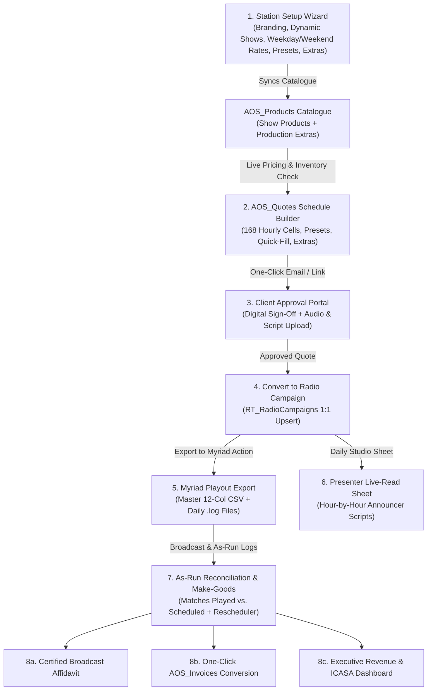

# CRMSuite — Radio Station Advertising, Traffic & Playout Management Platform
**Complete Technical & User Documentation (Version 2.5 — SuiteCRM 8.10.1 Edition)**

---

## Table of Contents
1. [Executive Overview](#1-executive-overview)
2. [System Architecture & Technology Stack](#2-system-architecture--technology-stack)
3. [End-to-End Broadcast Sales & Traffic Workflow](#3-end-to-end-broadcast-sales--traffic-workflow)
4. [Station Setup & Onboarding Wizard (`radio_station_wizard.php`)](#4-station-setup--onboarding-wizard)
5. [Dynamic Rate Card, Weekday vs. Weekend Pricing & Duration Multipliers](#5-dynamic-rate-card-weekday-vs-weekend-pricing--duration-multipliers)
6. [Weekly Advert Schedule Matrix & Quote Builder (`AOS_Quotes`)](#6-weekly-advert-schedule-matrix--quote-builder-aos_quotes)
   - [6.1 168-Cell Weekly Flighting Grid](#61-168-cell-weekly-flighting-grid)
   - [6.2 Exact Package Presets & Target Pre-VAT Pricing](#62-exact-package-presets--target-pre-vat-pricing)
   - [6.3 Auto-Distribute Quick-Fill Scheduler](#63-auto-distribute-quick-fill-scheduler)
   - [6.4 Production & Value-Add Extras Bundler](#64-production--value-add-extras-bundler)
   - [6.5 Real-Time Inventory Availability & Hourly Clutter Warnings](#65-real-time-inventory-availability--hourly-clutter-warnings)
7. [Radio Campaigns Module (`RT_RadioCampaigns`)](#7-radio-campaigns-module-rt_radiocampaigns)
8. [Myriad Playout Automation Export Engine](#8-myriad-playout-automation-export-engine)
9. [Playout As-Run Log Reconciliation & Make-Good Rescheduler](#9-playout-as-run-log-reconciliation--make-good-rescheduler)
10. [Studio Presenter Live-Read &Sponsorship Daily Run-Sheets](#10-studio-presenter-live-read--sponsorship-daily-run-sheets)
11. [Client Approval Portal & One-Click Email Dispatch](#11-client-approval-portal--one-click-email-dispatch)
12. [Broadcast Affidavits & One-Click Invoice Generation](#12-broadcast-affidavits--one-click-invoice-generation)
13. [Executive Revenue & ICASA Compliance Dashboard](#13-executive-revenue--icasa-compliance-dashboard)
14. [Database Schema & Custom Tables Reference](#14-database-schema--custom-tables-reference)
15. [Administration, CLI Operations, Backups & Automated Tests](#15-administration-cli-operations-backups--automated-tests)

---

## 1. Executive Overview

**CRMSuite (Radio CRM)** is an enterprise-grade broadcast advertising sales, traffic scheduling, playout automation, and regulatory compliance platform built on **SuiteCRM 8.10.1**. It is purpose-built for FM/community/commercial radio stations to manage the entire lifecycle of an advertising campaign from initial client quote to studio playout on **Broadcast Radio Myriad**, post-broadcast reconciliation, certified affidavits, ICASA regulatory reporting, and final invoicing.

### Key Highlights
- **100% White-Label & Multi-Station Ready**: All station branding, frequency, callsign, logos, banking details, tax/VAT rates, daypart shows, weekday/weekend rates, package presets, and production fees are dynamically managed via the **Station Setup & Onboarding Wizard**.
- **Precision Pricing Engine**: Supports distinct **Weekday (Mon–Fri)** and **Weekend (Sat–Sun)** rates per show/timeband, configurable ad duration scaling (`15s`, `30s`, `45s`, `60s`), and exact pre-VAT package preset pricing (`Package Preset 1–4` or unlimited custom presets).
- **168-Hour Visual Flighting Matrix**: Interactive 24-hour × 7-day schedule builder embedded directly inside Quotes (`AOS_Quotes`), complete with live hourly inventory heatmaps, clutter warnings, Quick-Fill auto-distribution, and 1-click Extras bundling.
- **Direct Myriad Playout Integration**: Exports frame-accurate 12-column Master CSV schedules and daily `.log` files with automatic intra-hour spot spacing (`:30:00`, `:20/:40`, `:15/:30/:45`) and audio cart range enforcement.
- **Closed-Loop Compliance**: Reconciles Myriad As-Run logs against booked schedules, flags missed spots, suggests Make-Good compensatory slots, prints daily Studio Presenter Live-Read sheets, generates signed Broadcast Affidavits, and tracks ICASA hourly commercial caps.

---

## 2. System Architecture & Technology Stack

| Layer | Technology | Purpose |
| :--- | :--- | :--- |
| **Application Framework** | SuiteCRM 8.10.1 (Symfony 5.4 + Legacy Core) | Hybrid Angular 18 UI shell + Legacy MVC modules (`AOS_Quotes`, `AOS_Products`, `AOS_Invoices`, `RT_RadioCampaigns`) |
| **Runtime Environment** | PHP 8.3 + Apache 2.4 (`radio_crm_web` container) | Configured with `max_input_vars = 5000` to handle 168 schedule grid inputs plus quote metadata |
| **Database** | MariaDB 10.11 (`radio_crm_mariadb` container) | Full `utf8mb4` relational storage for CRM records, 168 schedule columns, and JSON station configuration |
| **Core Domain Services** | `RadioStationConfigService.php`<br>`RadioScheduleService.php` | Central single-source-of-truth services for station configuration, rate card math, calendar date counting, Myriad export, and inventory checks |
| **Playout Export Volume** | `/srv/myriad_exports/` | Shared host/container directory (Samba-ready) where Myriad Studio workstations ingest scheduled `.csv` and `.log` files |
| **Backup & Recovery** | `/srv/radio_crm_backups/` | Automated database + custom code snapshots with self-contained `restore_radio_crm.sh` rollback scripts |

### System Workflow Diagram



---

## 3. End-to-End Broadcast Sales & Traffic Workflow

1. **Configure Station Profile (Admin)**:
   - Navigate to **Admin → Radio CRM & Playout Management → Station Setup & Onboarding Wizard**.
   - Set station branding, VAT percentage, banking details, show timebands (Weekday & Weekend rates), duration multipliers, package presets, and production/sponsorship extras.
2. **Build Client Quote (`AOS_Quotes`)**:
   - Create or edit a Quote, select **campaign start and end dates** and **Advert Duration (`15s`, `30s`, `45s`, `60s`)**.
   - Populate the **168-cell Weekly Advert Schedule** manually, via **One-Click Package Presets**, or via the **Auto-Distribute Quick-Fill Scheduler**.
   - Tick any **Production & Value-Add Extras** (e.g., Live Reads, Vox Pops, OB Van, Jingle Production).
   - Review real-time **Hourly Inventory Heatmap** warnings to avoid exceeding the station's ICASA commercial minutes cap.
   - Save the Quote — line items in `aos_products_quotes` and exact pre-VAT / VAT / Grand Total figures are calculated automatically.
3. **Client Review & Digital Sign-Off**:
   - Dispatch the **Client Schedule Review Portal** link via email directly from the portal or Campaign view.
   - The client reviews the flighting calendar, uploads their audio file (`.mp3`/`.wav`) or live-read script, and digitally approves the schedule with their name and PD/PO reference.
4. **Convert Quote to Radio Campaign (`RT_RadioCampaigns`)**:
   - On the Quote record, click **Convert to Radio Campaign**.
   - Assign a **Myriad Cart Number** (validated against your configured cart range, e.g., `1000–99999`).
5. **Export to Myriad & Print Presenter Sheets**:
   - Click **Export to Myriad** on the Radio Campaign record to generate the 12-column Master CSV and daily `.log` files in `/srv/myriad_exports/`.
   - Open **Presenter Live-Read Run-Sheets** to print daily studio announcer scripts for any hours that contain spots or live reads.
6. **Reconcile As-Run Logs & Schedule Make-Goods**:
   - Upload or process the Myriad As-Run CSV log.
   - If any spots were missed (e.g., due to power outage or breaking news), use the **Make-Good Compensatory Spot Rescheduler** to inspect open hours in the same show and append compensatory dates.
7. **Issue Broadcast Affidavit & Final Invoice**:
   - Generate the **Certified Broadcast Affidavit** (Proof of Performance) and click **Convert to Invoice** to create a finalized `AOS_Invoices` record.

---

## 4. Station Setup & Onboarding Wizard

Accessible via **Administration → Radio CRM & Playout Management → Station Setup & Onboarding Wizard** (`index.php?module=Administration&action=radio_station_wizard`), this 5-tab interface controls all global parameters across the platform.

### Tab 1: Station Branding & Identity
- **Identity**: Station Name, Frequency (`93.6 FM`), Callsign, Slogan/Tagline, Broadcast Language, Geographic Region, and Station License Category (Community / Commercial / Public / Campus).
- **Contact & Signatory**: Physical Address, Phone, Sales Email, Website URL, Station Manager Name & Title (appears on signed Broadcast Affidavits), and Traffic Manager Name & Email.
- **Logo Upload**: Live drag-and-drop PNG/JPG/SVG logo uploader (`upload/station_logo.*`), rendered on Quotes, Affidavits, Client Portals, and Dashboards.
- **Financial, Tax & Invoice Terms**: Currency Symbol (`R`), Currency Code (`ZAR`), Tax/VAT Rate (`15%`), Tax Registration Number, Default Quote Validity Days, Default Invoice Payment Terms, and Complete Bank Account Details (`Bank Name`, `Account Name`, `Account Number`, `Branch Code`, `Payment Reference Note`).

### Tab 2: Shows, Rate Card & Multipliers (Dynamic Rows)
- **Fully Dynamic Show Slots**: Add (`+ Add Show / Timeband`) or remove (`Remove`) as many show timebands as needed.
- **Editable Fields per Show**:
  - `Slot Key` (internal identifier)
  - `Product Part Number / Code` (e.g., `RAD-SLOT-1`, synced directly to `aos_products.part_number`)
  - `Show / Timeband Name` (e.g., `Breakfast Show`)
  - `Hours Description` (e.g., `06:00-09:00`)
  - `Active Hours Spec` (supports ranges and comma lists like `6-8` or `0-5,21-23`)
  - `Weekday 30s Rate` (Mon–Fri rate per 30-second spot)
  - `Weekend 30s Rate` (Sat–Sun rate per 30-second spot; automatically falls back to Weekday rate if set to `0` or left blank)
  - `Show Category` (`Prime` / `Standard` / `Graveyard`)
- **Editable Duration Multipliers**:
  - Configurable percentage scaling for `15s` (default `50%`), `30s` (default `100%`), `45s` (default `150%`), and `60s` (default `200%`).

### Tab 3: Package Presets & Extras (Dynamic Rows)
- **Quick-Select Package Presets**:
  - Add, edit, or remove preset buttons displayed above the Weekly Schedule grid on Quotes.
  - Each preset defines: `Preset Name`, `Badge Label`, `Description`, **`Target Package Pre-VAT Price`** (e.g., `R5,999.00`), `Duration (s)`, `Campaign Weeks`, `Default Hours`, `Apply Days` (`Mon–Fri`, `Sat–Sun`, or `Mon–Sun`), and `Spots/Hr`.
- **Production & Value-Add Catalogue Extras**:
  - Manage non-spot line items synced directly to `aos_products`: e.g., **Presenter Live Read (30s)** (`R360`), **Vox Pop Recording** (`R965`), **Outside Broadcast (OB Van - Per Hour)** (`R3,865`), **Commercial Production / Voiceover** (`R800`), **Jingle Creation** (`R2,900`).

### Tab 4: Traffic, Playout & ICASA Rules
- **ICASA & Clutter Caps**: Max Commercial Minutes per Hour (default `10` mins) and Max Spots per Hour (`20`).
- **Myriad Playout Rules**: Min Cart Number (`1000`), Max Cart Number (`99999`), Default Export Path (`/srv/myriad_exports`), and Lead Time Hours (`24`).
- **Compliance Footers**: Custom Quote Terms & Conditions, Affidavit Legal Declaration text, and ICASA Licence Number.

### Tab 5: Import / Export JSON Profile
- Export the entire station configuration to a portable `.json` file or import a station profile JSON with one click.

---

## 5. Dynamic Rate Card, Weekday vs. Weekend Pricing & Duration Multipliers

### Default Production Rate Card Reference (30-Second Base Rates)

| Code | Show / Timeband | Active Hours | Mon–Fri 30s Rate | Sat–Sun 30s Rate | Category |
| :--- | :--- | :--- | ---: | ---: | :--- |
| `RAD-SLOT-1` | **Breakfast Show** | `06:00–09:00` (`6-8`) | R 240.00 | R 145.00 | Prime |
| `RAD-SLOT-2` | **Mid-Morning Show** | `09:00–12:00` (`9-11`) | R 180.00 | R 145.00 | Standard |
| `RAD-SLOT-3` | **Lunch Show** | `12:00–14:00` (`12-13`) | R 200.00 | R 180.00 | Prime |
| `RAD-SLOT-4` | **Afternoon Drive** | `14:00–18:00` (`14-17`) | R 240.00 | R 180.00 | Prime |
| `RAD-SLOT-5` | **Evening Specialist Shows** | `18:00–21:00` (`18-20`) | R 145.00 | R 145.00 | Standard |
| `RAD-SLOT-6` | **Late Night Music** | `21:00–06:00` (`0-5,21-23`) | R 95.00 | R 95.00 | Graveyard |

### Pricing Calculation Formula
1. **Calendar Day Occurrence Counting**:
   - Given `campaign_start_date_c` and `campaign_end_date_c` (inclusive), `RadioScheduleService::countWeekdayOccurrences()` counts how many times each day of the week (`monday` through `sunday`) occurs within the campaign window.
2. **Weekday vs. Weekend Spot Separation**:
   - For each configured show slot:
     - **Weekday Spots** = $\sum_{d \in \{\text{Mon..Fri}\}} (\text{Weekly Spots in Show on Day } d \times \text{Occurrences of Day } d)$
     - **Weekend Spots** = $\sum_{d \in \{\text{Sat, Sun}\}} (\text{Weekly Spots in Show on Day } d \times \text{Occurrences of Day } d)$
3. **Duration Multiplier Scaling**:
   - $\text{Effective Weekday Unit Price} = \text{ round}(\text{Weekday 30s Rate} \times \text{Duration Multiplier}, 2)$
   - $\text{Effective Weekend Unit Price} = \text{ round}(\text{Weekend 30s Rate} \times \text{Duration Multiplier}, 2)$
4. **Separate Quote Line Items**:
   - Whenever a show has spots booked on both weekdays and weekends (and the Weekend rate differs from the Weekday rate), `RadioQuoteScheduleProducts` automatically generates two clear line items on the Quote:
     - `[Show Name] (Mon-Fri) - [Duration]s Radio Advert Slot` at the Weekday rate
     - `[Show Name] (Weekend) - [Duration]s Radio Advert Slot` at the Weekend rate

---

## 6. Weekly Advert Schedule Matrix & Quote Builder (`AOS_Quotes`)

### 6.1 168-Cell Weekly Flighting Grid
- Embedded directly inside the `AOS_Quotes` EditView (`custom/modules/AOS_Quotes/tpls/weekly_advert_schedule.tpl`).
- Consists of **24 hourly rows** (`00:00 - 01:00` through `23:00 - 24:00`) across **7 day columns** (`Monday` through `Sunday`) = **168 integer fields** (`slot_0000_monday_c` … `slot_2300_sunday_c`).
- Each row displays its mapped **Show Name**, **Weekday Rate badge**, and **Weekend Rate badge**.

### 6.2 Exact Package Presets & Target Pre-VAT Pricing
Above the grid, sales executives can click any **Package Preset** button:
- **Preset 1 — 30 Sec Ads (1 Month / 60 Spots)**: Target Pre-VAT Price = **R 5,999.00** (R 6,898.85 incl. 15% VAT).
- **Preset 2 — 30 Sec Ads (2 Months / 120 Spots)**: Target Pre-VAT Price = **R 10,800.00**.
- **Preset 3 — 45 Sec Ads (1 Month / 60 Spots)**: Target Pre-VAT Price = **R 9,100.00**.
- **Preset 4 — 45 Sec Ads (2 Months / 120 Spots)**: Target Pre-VAT Price = **R 16,250.00**.

**How Target Package Pricing Works**:
- Clicking a preset populates the designated hours/days, sets the campaign duration to produce the exact spot count (e.g., 28 days = 4 full weeks = 60 spots), and stores the package's target pre-VAT price in `package_override_price_c`.
- Both the live JavaScript/AJAX calculator and the server-side `RadioQuoteScheduleProducts` hook prorate the line-item unit prices and discount so the Quote Subtotal equals **exactly** the target package pre-VAT price (e.g., `R 5,999.00`), while explicitly displaying the rate-card savings discount!
- If the user manually edits any cell in the schedule grid, `package_override_price_c` clears automatically so standard rate-card pricing applies.

### 6.3 Auto-Distribute Quick-Fill Scheduler
Located in the Quote schedule toolbar, the **Quick-Fill Scheduler** allows sales reps to auto-populate spots without clicking individual cells:
- Enter **Target Total Spots** (e.g., `40`) or **Target Pre-VAT Budget (R)** (e.g., `R 8,000`).
- Choose **Day Filter**: `Weekdays (Mon–Fri)`, `Weekends (Sat–Sun)`, or `All Week (Mon–Sun)`.
- Choose **Timeband Filter**: `Prime Time Only`, `Daytime (06:00–18:00)`, `Balanced All Day (06:00–21:00)`, or `Evenings Only`.
- Click **Auto-Fill Grid** to evenly distribute the spots across the selected hours and days within the client's budget.

### 6.4 Production & Value-Add Extras Bundler
- Directly below the Quick-Fill bar, sales reps can tick any configured **Production & Value-Add Extras** (e.g., *Presenter Live Read*, *Outside Broadcast OB Van*, *Vox Pop*, *Commercial Production*) and specify a **Quantity**.
- When the Quote is saved, `RadioQuoteScheduleProducts` preserves all selected Extras alongside the calculated broadcast spot line items so they are never overwritten during schedule recalculations.

### 6.5 Real-Time Inventory Availability & Hourly Clutter Warnings
- As dates and spots are modified on a Quote, the schedule grid queries `radio_schedule_ajax_sync.php` (`check_inventory=1`), which aggregates all active/approved Quotes and Campaigns overlapping the selected date range.
- Any hour cell where total station commercial load approaches (≥80%) or exceeds (100%) the station's configured **Max Commercial Minutes per Hour** highlights in **Amber (Near Cap)** or **Red (Over Cap)** with a live tooltip showing already-booked minutes vs. current quote minutes, plus a summary banner above the grid.

---

## 7. Radio Campaigns Module (`RT_RadioCampaigns`)

`RT_RadioCampaigns` is a custom SuiteCRM module linked 1:1 with `AOS_Quotes` via `rt_radiocampaigns_aos_quotes_c`.

### Key Fields on `RT_RadioCampaigns`
| Field Name | Type | Description |
| :--- | :--- | :--- |
| `name` | `varchar` | Campaign Name (auto-populated from Quote Name + Account) |
| `myriad_cart_number` | `varchar(64)` | Audio Cart ID in Myriad Playout (`1000–99999`) |
| `campaign_start_date` | `date` | Inclusive start date of broadcast flighting |
| `campaign_end_date` | `date` | Inclusive end date of broadcast flighting |
| `advert_duration` | `enum` | `15`, `30`, `45`, or `60` seconds |
| `total_spots` | `int` | Total scheduled spots across the campaign window |
| `status` | `enum` | `draft`, `approved`, `exported_to_myriad`, `in_flight`, `completed`, `cancelled` |
| `reconciliation_status_c` | `enum` | `pending`, `reconciled`, `discrepancy` |
| ` spots_played_c` / `spots_missed_c` | `int` | Reconciled played and missed spot counts from Myriad As-Run logs |
| `client_approval_status_c` | `enum` | `pending`, `approved`, `changes_requested` |
| `makegood_dates_c` | `text` | Comma-separated compensatory flighting dates (`YYYY-MM-DD`) |

---

## 8. Myriad Playout Automation Export Engine

Triggered via the **Export to Myriad** button on any `RT_RadioCampaigns` record (handled by both Symfony `ExportToMyriadAction.php` for SuiteCRM 8 Record View and `export_radio_campaign_to_myriad.php` for Legacy View):

1. **Strict Pre-Flight Validation**:
   - Verifies `myriad_cart_number` is present and falls within the station's configured range (`min_cart_number` to `max_cart_number`).
   - Verifies linked `AOS_Quotes` record exists, `campaign_start_date <= campaign_end_date`, and `total_spots > 0`.
2. **Intra-Hour Even Spot Spacing (`RadioScheduleService::expandDailyHourPlays`)**:
   - When an hour cell has $N$ plays booked, the exporter spaces them evenly inside that hour using $\lfloor 60 / (N + 1) \rfloor$ minute intervals:
     - **1 play/hr**: `HH:30:00`
     - **2 plays/hr**: `HH:20:00`, `HH:40:00`
     - **3 plays/hr**: `HH:15:00`, `HH:30:00`, `HH:45:00`
3. **Make-Good Dates Inclusion**:
   - Any compensatory dates stored in `makegood_dates_c` are automatically appended to the export calendar using their corresponding weekday schedule pattern.
4. **Generated Output Files in `/srv/myriad_exports/`**:
   - **Master 12-Column CSV** (`campaign_<id>_<timestamp>.csv`):
     `PlayDate, PlayTime, CartNumber, CampaignName, QuoteNumber, AccountName, ShowSlot,ShowHours, DayOfWeek, PlayIndexInHour, PlaysInHour, DurationSeconds`
   - **Per-Day Myriad `.log` Files** (`myriad_<YYYYMMDD>_cart_<CartNumber>.log`):
     Ready for direct ingestion by Broadcast Radio Myriad AutoTrack / Playout log importers.

---

## 9. Playout As-Run Log Reconciliation & Make-Good Rescheduler

Accessible from a Campaign record or via **Admin → As-Run Log Reconciliation** (`index.php?module=Administration&action=radio_reconcile_logs`):

1. **As-Run Log Comparison**:
   - Compares every scheduled play (`Date + Hour + CartNumber`) against the Myriad As-Run CSV (`reconcile_myriad_logs.php`).
   - Updates `spots_played_c`, `spots_missed_c`, `reconciliation_status_c` (`reconciled` vs. `discrepancy`), and `reconciliation_notes_c`.
2. **Interactive Make-Good Compensatory Spot Rescheduler**:
   - When missed spots are detected (`spots_missed_c > 0`), the reconciliation screen displays:
     - **Recommended Compensatory Timebands**: Available hours in the same show daypart that are well below the ICASA hourly commercial cap.
     - **One-Click Make-Good Date Appender**: Select a compensatory broadcast date (`YYYY-MM-DD`) and optionally extend `campaign_end_date` in one click. Re-exporting to Myriad immediately includes the Make-Good plays.

---

## 10. Studio Presenter Live-Read & Sponsorship Daily Run-Sheets

Accessible via **Administration → Presenter Live-Read Run-Sheets** (`index.php?module=Administration&action=radio_liveread_sheet`):

- Generates a print-ready **Daily Studio Announcer Sheet** for any selected broadcast date (`YYYY-MM-DD`) and optional Show Timeband filter.
- Automatically aggregates:
  1. All campaigns active on that date (or scheduled for a Make-Good on that date) with spots booked on that weekday.
  2. Any quotes/campaigns that include **Presenter Live Reads**, **Sponsorship Mentions**, or **Outside Broadcast** extras.
  3. Any live-read scripts or audio material instructions uploaded by the client via the Client Approval Portal.
- Organizes the sheet **Hour-by-Hour (`00:00` to `23:00`)** with interactive studio checkboxes (`[ ] Read on Air`) and a physical **Presenter & Producer Sign-Off** block at the bottom.

---

## 11. Client Approval Portal & One-Click Email Dispatch

Accessible via `index.php?entryPoint=radio_campaign_client_review&campaign_id=<ID>`:

1. **Token-Secured Public Review Link**:
   - Each campaign has a deterministic HMAC security token (`hash_hmac('sha256', $campaignId, 'radio_crm_client_portal_salt')`).
2. **One-Click Email Dispatch to Client**:
   - Internal staff see a **"Send Portal Link to Client"** toolbar at the top of the portal page, pre-populated with the client's Billing Account email address.
   - Clicking **Email Link to Client** sends a branded HTML email via SuiteCRM's configured `SugarPHPMailer` (or logs the dispatch to `upload/client_portal_email_log.txt` if SMTP is offline).
3. **Creative Audio & Live-Read Script Upload**:
   - Clients can upload their broadcast audio (`.mp3`, `.wav`, `.ogg`, `.m4a`, `.aac`) or paste their **Presenter Live-Read Script & Pronunciation Guide** directly in the portal (saved to `upload/campaign_creatives/<campaign_id>/`).
4. **Digital Sign-Off**:
   - Clients can click **Approve Schedule for Broadcast** (recording their name, PO/Reference, timestamp, and setting `status = approved`) or **Request Schedule Adjustments**.

---

## 12. Broadcast Affidavits & One-Click Invoice Generation

- **Certified Broadcast Affidavits** (`index.php?entryPoint=generate_broadcast_affidavit&campaign_id=<ID>`):
  - Generates an official, printable Proof-of-Performance document displaying Station Logo, Campaign Metadata, Reconciled vs. Scheduled Spot Counts, Daypart Breakdown, ICASA Licence Footer, and the Station Manager's signature block.
- **One-Click Campaign-to-Invoice Conversion** (`index.php?entryPoint=convert_campaign_to_invoice&campaign_id=<ID>`):
  - Converts a Campaign and its linked Quote directly into a SuiteCRM `AOS_Invoices` record, copying all spot and production line items, banking details, and VAT totals.

---

## 13. Executive Revenue & ICASA Compliance Dashboard

Accessible via **Administration → Executive Revenue & ICASA Dashboard** (`index.php?module=Administration&action=radio_Analytics_dashboard`):

- **Executive KPI Cards**:
  - **Contracted Quote Value (Excl. VAT)** and **Invoiced Revenue (Incl. VAT)**.
  - **Active / Total Campaigns** and **Total Scheduled Spots** (`Played` vs. `Missed`).
  - **Peak Hourly Commercial Load** vs. the station's configured ICASA cap.
- **Revenue & Spot Volume by Show Daypart**:
  - Visual breakdown of which shows (e.g., *Breakfast Show*, *Afternoon Drive*) generate the highest spot volume and revenue across Weekday and Weekend rates.
- **24-Hour Commercial Clutter Heatmap**:
  - Color-coded 24-hour bar chart (`Green = Normal`, `Amber = ≥80% Cap`, `Red = Exceeds Cap`) for immediate ICASA compliance verification.
- **Top Advertising Clients Leaderboard**:
  - Ranks top accounts by contracted pre-VAT spend, quote count, and total spots.

---

## 14. Database Schema & Custom Tables Reference

1. **`radio_station_settings` Table**:
   - Stores key-value JSON configuration (`station_branding`, `show_slots`, `rate_card`, `duration_multipliers`, `package_presets`, `catalogue_extras`, `traffic_rules`).
2. **`aos_quotes_cstm` (Custom Quote Columns)**:
   - `campaign_start_date_c` (`date`), `campaign_end_date_c` (`date`), `advert_duration_c` (`varchar`), `total_spots_c` (`int`), `package_override_price_c` (`decimal(26,6)`), plus **168 integer columns** (`slot_0000_monday_c` through `slot_2300_sunday_c`).
3. **`rt_radiocampaigns` & `rt_radiocampaigns_cstm`**:
   - Core campaign table and reconciliation/approval custom fields (`reconciliation_status_c`, `spots_played_c`, `spots_missed_c`, `last_reconciled_at_c`, `reconciliation_notes_c`, `client_approval_status_c`, `client_approved_by_c`, `client_approved_at_c`, `makegood_dates_c`, `creative_notes_c`, `creative_file_c`, `invoice_id_c`).
4. **`rt_radiocampaigns_aos_quotes_c`**:
   - Relationship join table linking `RT_RadioCampaigns` and `AOS_Quotes`.

---

## 15. Administration, CLI Operations, Backups & Automated Tests

### Important SuiteCRM 8 Admin Menu Routing Rule
In SuiteCRM 8, `AdminPanelDefinitionHandler` converts all links in `custom/Extension/modules/Administration/Ext/Administration/*.php` via `RouteConverterHandler::convertUri()`. Every admin menu URL **must** include `module=Administration&action=<action_name>` (backed by a thin wrapper in `custom/modules/Administration/<action_name>.php`). Never use bare `?entryPoint=...` without `module=` in `$admin_option_defs`, as that causes `/api/app-metadata/app` to fail and hides the top navigation bar.

### Useful CLI Commands
```bash
# 1. Deploy code changes from /home/ubuntu/suitecrm to /var/www/html and run migrations
sudo ./scripts/deploy.sh

# 2. Run the full 57-assertion automated test suite (Acceptance, Market Enhancements, Wizard, UI/Symfony)
sudo ./scripts/smoke_test.sh

# 3. Inspect or import station configuration via CLI
docker exec -u www-data radio_crm_web php /opt/radio_crm_repo/scripts/setup_station.php status

# 4. Run Myriad As-Run log reconciliation via CLI
docker exec -u www-data radio_crm_web php /opt/radio_crm_repo/scripts/reconcile_myriad_logs.php /path/to/asrun.csv <campaign_id>

# 5. Generate monthly ICASA compliance report via CLI
docker exec -u www-data radio_crm_web php /opt/radio_crm_repo/scripts/generate_icasa_report.php 2026-10

# 6. Create a full database + file backup snapshot
sudo ./scripts/backup.sh manual_snapshot
```
